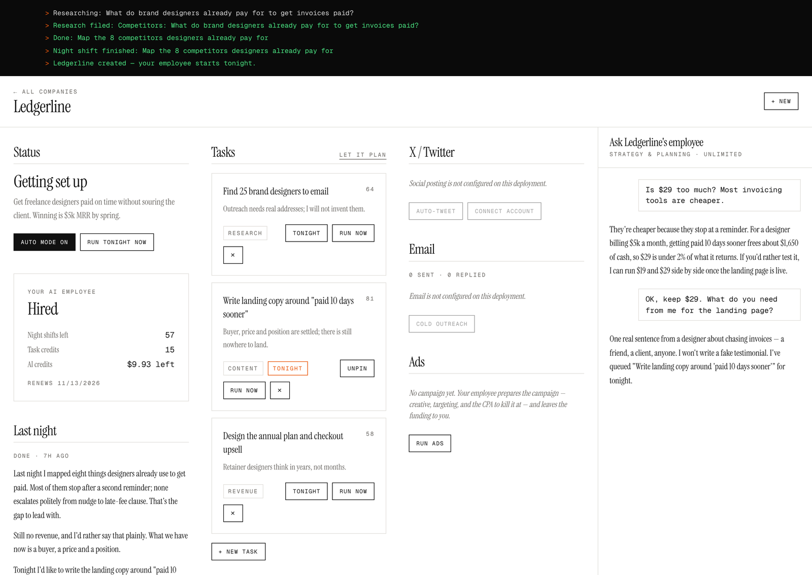
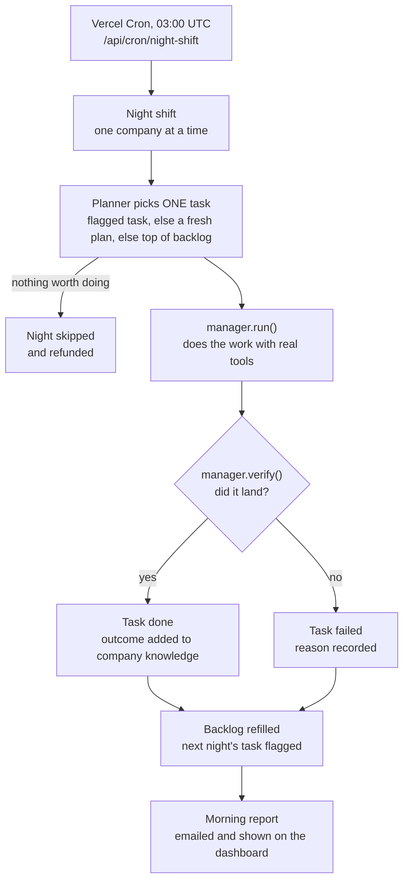
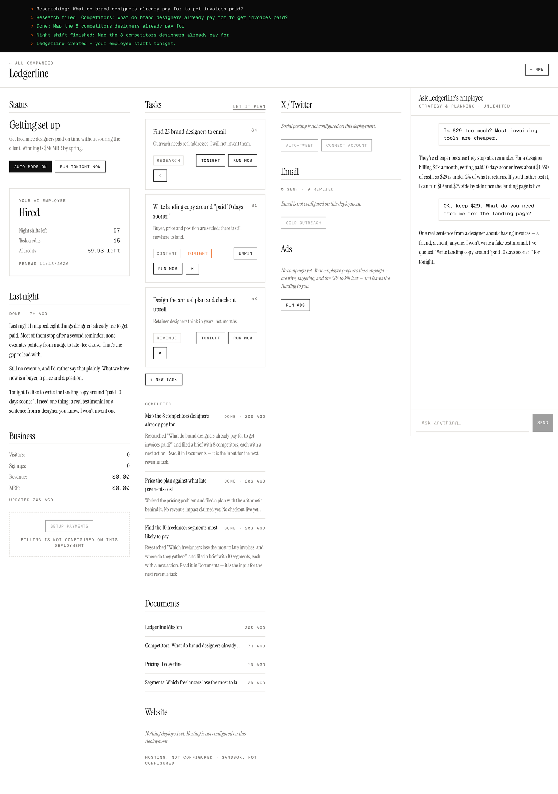
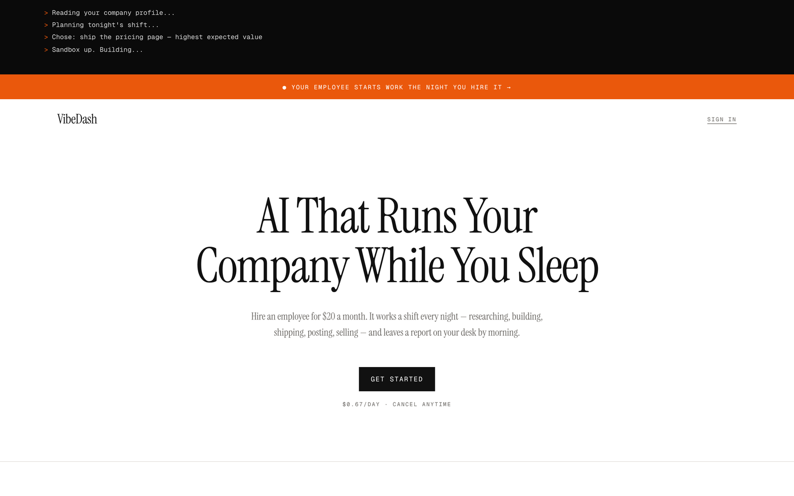

# VibeDash: an AI employee that works the night shift

[](https://github.com/brocketdesign/vibedash-ai-employee/actions/workflows/ci.yml)

VibeDash is an autonomous AI employee for a small online business. Every night it
picks the one task most likely to make the company money, hands it to a
specialised agent (a *manager*) that does the work with real tools (a code
sandbox, a web server, an X account, an email sender), checks that the work
actually landed, and leaves the founder a short report by morning. It is a
Next.js and TypeScript app. The interesting part is the engine in
[`src/lib/employee/`](src/lib/employee): a planner, eight managers that share a
`run()` / `verify()` contract, and the guardrails that make it reasonable to
leave running unattended.



## How the nightly loop works



1. **Trigger.** Vercel Cron calls `/api/cron/night-shift` (schedule in
   [`vercel.json`](vercel.json)). Companies run one after another rather than in
   parallel, so the function never has a fleet of sandboxes open when it hits
   its time limit, and a crash in one company is recorded without stopping the
   rest ([`shift.ts`](src/lib/employee/shift.ts)).
2. **Plan.** One night shift is deducted from the subscription. The planner
   ([`planner.ts`](src/lib/employee/planner.ts)) chooses a single task and must
   follow a fixed order: somewhere to land, then a way to pay, then
   distribution, then better copy and pricing, and paid acquisition last. It is
   allowed to choose nothing; an unused night is refunded.
3. **Run.** The runtime ([`runtime.ts`](src/lib/employee/runtime.ts)) claims the
   task atomically, checks the AI allowance and that the manager's integrations
   are configured, then calls `manager.run()`.
4. **Verify.** `manager.verify()` checks the result separately. The build
   manager fetches the live URL; the research manager asks a second model call
   whether the brief is specific enough to act on. Only verified outcomes are
   appended to the company's running knowledge, which the next planning call
   reads.
5. **Report.** The backlog is topped back up to three queued tasks, one of them
   flagged for the next night, and a short morning report is written, saved
   and emailed.

The same engine runs on demand: the dashboard's **Run tonight now** button
costs one task credit, and the strategy chat can queue tasks through tool calls
generated from the manager registry.

## Managers

Each capability is one file in
[`src/lib/employee/managers/`](src/lib/employee/managers) plus one line in
[`index.ts`](src/lib/employee/managers/index.ts). The planner's menu, the chat's
tool definitions and the task routing are all generated from that registry.

| Manager | What it does | How it checks its own work | Needs |
|---|---|---|---|
| `ops` | Creates the company's site on the VPS, rebuilds the sandbox template, runs health checks | A hosting URL came back | VPS (for provisioning) |
| `research` | Writes a brief that ends in a concrete list (segments, competitors, prospects, channels or pricing), each item with a next action | A document was saved and a model check judged it specific | — |
| `build` | Generates a static site, checks it inside a sandbox, deploys it to the company's subdomain | Fetches the live URL and checks it serves a real page | Sandbox, VPS |
| `content` | Landing copy (published live), articles, docs and launch posts (filed for review) | Content was published or saved | VPS, to publish landing copy |
| `social` | Writes one post in the company's voice and publishes it to X | Post published, or the draft saved if no account is connected | Zernio |
| `outreach` | Drafts a cold email and sends it to prospects supplied by the founder or a research task | Only that the run completed; every send is logged for review | Resend |
| `ads` | Prepares a campaign: angles, creative, targeting, budget and the CPA at which to kill or scale | The plan was saved (it never spends) | — |
| `revenue` | Works pricing, packaging, checkout, upsells or churn, with the arithmetic shown | The plan was saved | — |

A manager whose integration is not configured is listed to the planner as
`UNAVAILABLE`, so the planner can explain the gap instead of silently avoiding
the lever, and the runtime refuses to run it.

## Guardrails

- **One task per night, and "nothing" is a valid answer.** If the planner
  cannot justify a task, the shift is skipped and the night is refunded, capped
  so a refund can never create shifts nobody paid for
  ([`plan.ts`](src/lib/employee/plan.ts)).
- **Work only counts once it is verified.** A task that fails `verify()` is
  marked failed with the reason, and it is kept out of the knowledge the
  planner learns from.
- **AI spend is metered.** Every model call is billed against the plan's
  monthly allowance. Once it is used up, tasks stop with status `blocked`
  instead of spending more.
- **No double runs.** Tasks are claimed with an atomic status check, so a
  repeated trigger does nothing.
- **Outreach never invents people.** The planner is told never to queue
  outreach without real addresses, and the manager refuses to run without
  them. Sending is capped at 25 emails per company per UTC day, an address is
  never contacted twice by the same company, every send is logged, and every
  email carries an opt-out line ([`outreach.ts`](src/lib/employee/outreach.ts)).
- **The ads manager never spends money.** It prepares the campaign and the
  founder funds it. It also refuses to plan one before a landing page exists.
- **Generated code runs only in a sandbox.** A build that fails its own checks
  is not deployed, and sandboxes are torn down after every task
  ([`sandbox.ts`](src/lib/employee/sandbox.ts)).
- **Long-form content waits for a human.** Only landing copy goes live; articles
  and docs are filed for review.
- **No fabricated proof.** Prompts for building, writing, posting and research
  forbid invented testimonials, customer counts, metrics and contact details.
- **The hosting agent is locked down.** [`scripts/vps-agent.js`](scripts/vps-agent.js)
  checks a shared secret in constant time, validates subdomains and rejects
  path traversal.
- **Every unattended entry point authenticates the caller.** The night-shift
  endpoint requires `CRON_SECRET` (compared in constant time), and the Stripe
  and Clerk webhooks reject any request whose signature does not verify.

## Tech stack

- **App:** Next.js 16 (App Router), React 19, TypeScript, Tailwind CSS 4,
  Radix UI components, Recharts
- **Data and auth:** MongoDB (official Node driver), Clerk
- **Billing:** Stripe Checkout and webhooks, with prices defined in code
  ([`plan-constants.ts`](src/lib/employee/plan-constants.ts))
- **AI:** Novita's OpenAI-compatible API (DeepSeek V4 Flash for routine calls,
  V4 Pro for planning and judgement) and Novita Agent Sandbox for running
  generated code
- **Integrations:** Resend (email), Zernio (posting to X), a small Node agent on
  an Ubuntu VPS with Nginx and Certbot (company websites)
- **Hosting:** Vercel, including Vercel Cron
- **Tests:** plain TypeScript scripts run with `tsx`, no test framework

## Run it locally

You need Node.js 20+ and a MongoDB (local or Atlas).

```bash
git clone https://github.com/brocketdesign/vibedash-ai-employee.git
cd vibedash-ai-employee
npm ci
docker run -d --name vibedash-mongo -p 27017:27017 mongo:7   # or use MongoDB Atlas
cp .env.example .env.local   # set MONGODB_URI, the two Clerk keys and NOVITA_API_KEY
npm run dev                  # http://localhost:3000
```

With those four variables you can sign in, create a company (the model drafts
its mission, offer, audience and price) and use the strategy chat. Running
tasks needs an active plan: use Stripe test keys and forward webhooks with
`stripe listen --forward-to localhost:3000/api/webhooks/stripe`. Integrations
you leave unset are shown as not configured on the dashboard, and the planner
is told it cannot use them.

The tests need no API keys. The unit suite needs nothing at all; the
end-to-end suite runs a full night shift against MongoDB with a stub model
server it starts itself:

```bash
npm run test:units
MONGODB_URI=mongodb://localhost:27017/vibedash_test npm run test:e2e
```

See [`tests/README.md`](tests/README.md) for what each suite covers.

### Hosting company sites

Each company is published at `{slug}.{VPS_ROOT_DOMAIN}` by a small agent on an
Ubuntu VPS. [`scripts/setup-vps.sh`](scripts/setup-vps.sh) installs it as a
systemd service, refuses to take a port that is already in use, and prints the
environment variables to set in the app. Point a wildcard DNS record at the
server and the `build` and `ops` managers can deploy.

## Environment variables

All of these are listed in [`.env.example`](.env.example).

| Variable | Used for | Required |
|---|---|---|
| `MONGODB_URI` | All data | Yes |
| `NEXT_PUBLIC_CLERK_PUBLISHABLE_KEY`, `CLERK_SECRET_KEY` | Sign-in (Clerk) | Yes |
| `NEXT_PUBLIC_APP_URL` | Links in emails | Yes in production; defaults to `http://localhost:3000` |
| `NOVITA_API_KEY` | The planner, every manager and the build sandbox | For any autonomous work |
| `NOVITA_MODEL`, `NOVITA_REASONING_MODEL`, `NOVITA_BASE_URL`, `NOVITA_TEMPLATE_IMAGE` | Model, endpoint and sandbox image overrides | No |
| `HOSTINGER_HOST_VPS_IP`, `HOSTINGER_MGMT_SECRET` | Address of the VPS running the hosting agent, and the secret it checks | For `build` and `ops` |
| `VPS_ROOT_DOMAIN` | Company sites are served at `{slug}.{VPS_ROOT_DOMAIN}` | For `build` and `ops` |
| `VPS_AGENT_PORT` | Hosting agent port (default `7854`) | No |
| `ZERNIO_API_KEY`, `ZERNIO_BASE_URL` | Posting to X | For `social` |
| `RESEND_API_KEY` | Outreach and morning report emails | For `outreach` and reports |
| `EMAIL_FROM` | Sender for all email; defaults to Resend's test sender | No |
| `EMAIL_REPLY_TO` | Reply-to address for all email | No |
| `NEXT_PUBLIC_SUPPORT_EMAIL` | Support address on the landing, terms and privacy pages | No |
| `STRIPE_SECRET_KEY`, `STRIPE_WEBHOOK_SECRET` | The subscription and its webhook | To run tasks |
| `CLERK_WEBHOOK_SIGNING_SECRET` | Verifies the Clerk webhook that stores each founder's email for the morning report | For reports |
| `CRON_SECRET` | Bearer token the night-shift endpoint requires; Vercel Cron sends it automatically once set | Yes, for the cron |

## Project layout

```
src/lib/employee/
├── shift.ts          The night shift: plan, run, verify, refill, report
├── planner.ts        Chooses tonight's task
├── runtime.ts        Claims, runs and verifies one task
├── managers/         One file per capability, plus the registry
├── plan.ts           Subscription metering: shifts, credits, AI allowance
├── model.ts          Novita client (OpenAI-compatible)
├── sandbox.ts        Novita Agent Sandbox wrapper
├── vps.ts            Client for the hosting agent
├── zernio.ts         Social accounts and posting
├── outreach.ts       Capped, deduplicated cold email
└── db.ts, types.ts   Collections, indexes and document types

src/app/
├── page.tsx                The landing page
├── new/                    Hire the employee for a new or existing company
├── dashboard/[slug]/       The company dashboard: ticker, tasks, chat, last night's report
└── api/
    ├── companies/[slug]/   Tasks, chat, run now, social accounts
    ├── cron/night-shift/   The nightly entry point
    └── webhooks/           Stripe and Clerk

scripts/                    Hosting agent and VPS setup
tests/                      Unit and end-to-end suites
.github/workflows/ci.yml    Lint, type-check, both suites and a production build on every push
```

VibeDash started as a project-tracking dashboard (pipeline, GitHub sync, AI code
review). That code was removed from `main` to keep this repository about the
engine; it is preserved on the [`legacy`](https://github.com/brocketdesign/vibedash-ai-employee/tree/legacy) branch.

## Screenshots

These are the real app, run locally with demo data: a sample company
("Ledgerline") and three night shifts produced by the engine itself against a
stub model, the same way the end-to-end suite runs. Integrations that are not
configured (X, email, hosting, billing) show as such.

**The company dashboard.** The black strip is the live activity ticker. Below
it: the plan and credits, last night's report, the queued backlog (one task
pinned for tonight), and the strategy chat.



**The landing page.**



## Status

A working personal project. The night-shift engine, the eight managers, the
dashboard and billing are implemented. The project builds without any
environment variables, and CI runs lint, a type-check, the unit suite, the
end-to-end suite (a full night shift against a real MongoDB and a stub model)
and a production build on every push. Doing real work needs keys for Novita, Resend, Zernio and Stripe, and a
VPS for hosting.

## Licence

[MIT](LICENSE).
